# Brain Tumor MRI Classification With Models

A deep learning project that compares four architectures for classifying brain MRI images into four categories: **glioma**, **meningioma**, **pituitary tumor**, and **no tumor**.

The project explores **3-phase progressive fine-tuning strategies**, evaluates model performance on a held-out test set, and uses visualization techniques (**Grad-CAM**) to investigate model predictions across both convolutional and Vision Transformer backbones.

This project I refactored from my [Kaggle Notebook](https://www.kaggle.com/code/onphct/brain-tumor-mri-classification-with-models). So, for the interactive report,
phase-by-phase training logs, confusion matrices, and cross-architecture Grad-CAM visualizations, especially the result of training and evaluating, it is recommended to check the notebook directly. 

---

## Project Structure

```text
Brain-Tumor-MRI-Classification/
├── assets/
│   ├── confusion_matrices/                  # Confusion matrix heatmaps per architecture
│   ├── gradcam/                             # Cross-architecture Grad-CAM visualizations
│   └── experimental_results_comparison.png  # 6-panel benchmark comparison figure
├── notebooks/
│   └── brain-tumor-mri-classification-with-models.ipynb
├── src/
│   ├── __init__.py
│   ├── dataset.py                           # Stratified splitting, transforms & DataLoaders
│   ├── models.py                            # CustomCNN, ResNet18, DenseNet121, DINOv3 & phase configs
│   ├── engine.py                            # Training/validation loops & frozen BatchNorm handling
│   ├── evaluate.py                          # Metrics, confusion matrix & benchmark plotting
│   └── gradcam.py                           # Grad-CAM & DINOv3 patch-token reshape pipeline
├── train.py                                 # CLI entrypoint for single-phase or 3-phase training
├── evaluate.py                              # CLI entrypoint for single-model or full benchmark evaluation
├── gradcam.py                               # CLI entrypoint for Grad-CAM visualization
├── requirements.txt
├── .gitignore
└── README.md
```

---

## Models and Experiments

The following four architectures are evaluated:

- **Custom CNN** (3 convolutional blocks + adaptive average pooling + classifier head, ~0.10M parameters)
- **ResNet-18** (~11.18M parameters)
- **DenseNet-121** (~6.96M parameters)
- **DINOv3 ViT-S/16** (`facebook/dinov3-vits16-pretrain-lvd1689m`, ~21.60M parameters)

Beyond training a baseline CNN from scratch, the experiments investigate a **3-phase progressive fine-tuning strategy** for the pretrained models:
1. **Phase 1 (Feature Extraction / Linear Probing):** Freeze the entire pretrained backbone and train only the classification head (`lr=1e-3`).
2. **Phase 2 (Partial Fine-Tuning — Top Blocks):** Unfreeze the top convolutional/transformer blocks (`layer4` for ResNet-18, `denseblock4` + `norm5` for DenseNet-121, last 2 Transformer blocks + `norm` for DINOv3) with decayed learning rates.
3. **Phase 3 (Deeper Partial Fine-Tuning):** Unfreeze deeper blocks (`layer3` & `layer4` for ResNet-18, `denseblock3` & `denseblock4` for DenseNet-121, last 4 Transformer blocks for DINOv3) with fine-grained discriminative learning rates.

---

## Dataset

This project uses the [Brain Tumor MRI Dataset by Masoud Nickparvar](https://www.kaggle.com/datasets/masoudnickparvar/brain-tumor-mri-dataset).

The dataset contains **7,200 MRI images** across four classes (`glioma`, `meningioma`, `notumor`, `pituitary`):
- **Training & Validation:** 5,600 images, partitioned using an 80/20 stratified split (`random_state=42` → 4,480 training and 1,120 validation images).
- **Testing:** 1,600 images (400 per class), reserved strictly for final evaluation.

---

## Installation & Setup

### 1. Install Dependencies

```bash
pip install -r requirements.txt
```

### 2. Download Dataset

Download the [Brain Tumor MRI Dataset by Masoud Nickparvar](https://www.kaggle.com/datasets/masoudnickparvar/brain-tumor-mri-dataset) and extract it into a `data/` directory (or use the Kaggle CLI):

```bash
kaggle datasets download -d masoudnickparvar/brain-tumor-mri-dataset
unzip brain-tumor-mri-dataset.zip -d data/
```

Expected directory layout:
```text
data/
├── Training/
│   ├── glioma/
│   ├── meningioma/
│   ├── notumor/
│   └── pituitary/
└── Testing/
    ├── glioma/
    ├── meningioma/
    ├── notumor/
    └── pituitary/
```

### 3. Setup Hugging Face Token (For DINOv3)

**DINOv3 ViT-S/16** (`facebook/dinov3-vits16-pretrain-lvd1689m`) is a gated model. Request access on [Hugging Face](https://huggingface.co/facebook/dinov3-vits16-pretrain-lvd1689m) and configure your User Access Token using one of the following methods:

- **Option A: Using a `.env` file (Recommended):**
  Create a `.env` file in the project root directory:
  ```env
  HF_TOKEN=hf_your_actual_token_here
  ```
  *(The `.env` file is already added to `.gitignore` so your secret token will never be pushed to GitHub).*

- **Option B: Setting directly in Terminal:**
  - **Linux / macOS:**
    ```bash
    export HF_TOKEN="hf_your_actual_token_here"
    ```
  - **Windows (PowerShell):**
    ```powershell
    $env:HF_TOKEN="hf_your_actual_token_here"
    ```
  - **Windows (CMD):**
    ```cmd
    set HF_TOKEN=hf_your_actual_token_here
    ```

- **Option C: Passing via CLI flag:**
  You can also pass it directly when running scripts:
  ```bash
  python train.py --model dinov3 --hf-token "hf_your_actual_token_here" ...
  ```

---

## Usage

### 1. Training

Train Custom CNN from scratch or run progressive 3-phase fine-tuning on pretrained backbones:

```bash
# Train Custom CNN from scratch
python train.py --model custom_cnn --train-dir data/Training --test-dir data/Testing

# Run 3-phase progressive fine-tuning on ResNet-18, DenseNet-121, or DINOv3
python train.py --model resnet18 --phase all --train-dir data/Training --test-dir data/Testing
python train.py --model densenet121 --phase all --train-dir data/Training --test-dir data/Testing
python train.py --model dinov3 --phase all --train-dir data/Training --test-dir data/Testing
```

### 2. Evaluation

Evaluate a single checkpoint or benchmark all four models:

```bash
# Evaluate a single model checkpoint
python evaluate.py \
    --model densenet121 \
    --checkpoint checkpoints/best_densenet121_phase3.pth \
    --train-dir data/Training \
    --test-dir data/Testing

# Benchmark all four models
python evaluate.py \
    --train-dir data/Training \
    --test-dir data/Testing \
    --custom-cnn-ckpt checkpoints/best_custom_cnn_phase1.pth \
    --resnet18-ckpt checkpoints/best_resnet18_phase3.pth \
    --densenet121-ckpt checkpoints/best_densenet121_phase3.pth \
    --dinov3-ckpt checkpoints/best_dinov3_phase3.pth
```

### 3. Grad-CAM Explainability

Generate side-by-side Grad-CAM overlays across all four architectures:

```bash
python gradcam.py \
    --train-dir data/Training \
    --test-dir data/Testing \
    --custom-cnn-ckpt checkpoints/best_custom_cnn_phase1.pth \
    --resnet18-ckpt checkpoints/best_resnet18_phase3.pth \
    --densenet121-ckpt checkpoints/best_densenet121_phase3.pth \
    --dinov3-ckpt checkpoints/best_dinov3_phase3.pth
```

---

## Results

The table below summarizes the final test set performance using the best validation checkpoint for each architecture:

| Model | Best Training Strategy | Parameters (M) | FE Test Acc (%) | FT Test Acc (%) | Macro F1 |
|---|---|---:|---:|---:|---:|
| **Custom CNN** | Trained from scratch | 0.10M | — | 81.44% | 0.8060 |
| **ResNet-18** | Fine-tuned `layer3`, `layer4` & head (Phase 3) | 11.18M | 85.38% | 94.31% | 0.9415 |
| **DenseNet-121** | Fine-tuned `denseblock3`, `denseblock4` & head (Phase 3) | 6.96M | 87.31% | 94.44% | 0.9430 |
| **DINOv3 ViT-S/16** | Fine-tuned last 4 Transformer blocks & head (Phase 3) | 21.60M | 87.94% | **95.06%** | **0.9495** |

> [!NOTE]
> **Notation & Training Strategies:**
> - **FE (Feature Extraction / Linear Probing — Phase 1):** The entire pretrained backbone is completely frozen; only the newly attached linear classification head is trained (`lr=1e-3`).
> - **FT (Partial Fine-Tuning — Phase 3):** Deeper feature layers/blocks (e.g., `layer3` & `layer4` in ResNet-18, `denseblock3` & `denseblock4` in DenseNet-121, last 4 Transformer blocks in DINOv3) are progressively unfrozen and fine-tuned alongside the classification head with smaller, discriminative learning rates.
> - **Custom CNN:** Trained entirely from scratch without pretrained weights, so the FE strategy does not apply.

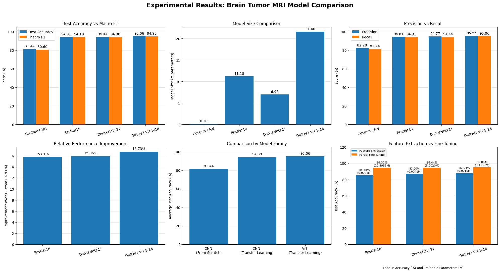

### Confusion Matrices

| Custom CNN (81.44%) | ResNet-18 (94.31%) |
|:---:|:---:|
| 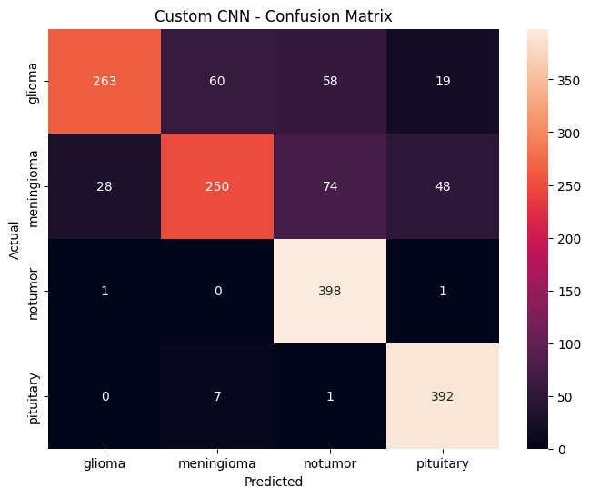 | 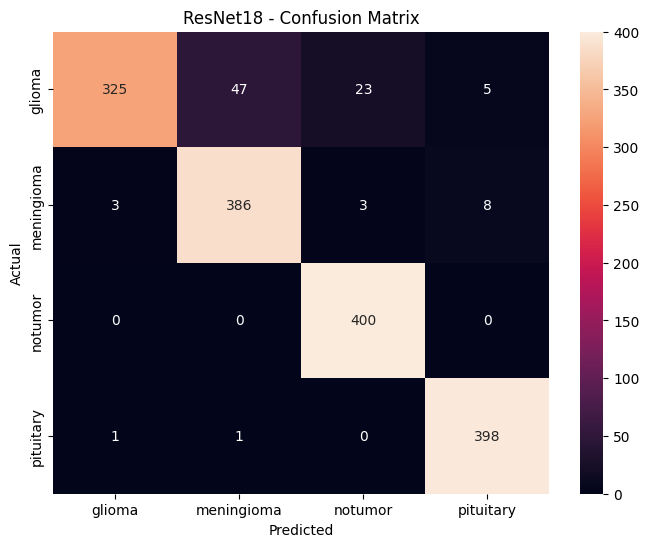 |
| **DenseNet-121 (94.44%)** | **DINOv3 ViT-S/16 (95.06%)** |
|  | 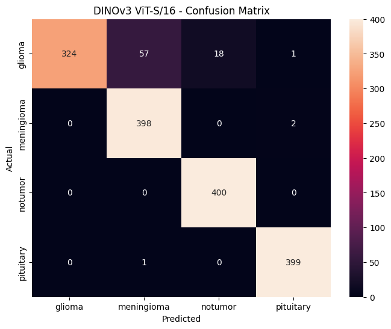 |

### Key Observations

- **Progressive Fine-Tuning Impact:** Unfreezing deeper blocks in Phases 2 and 3 yielded substantial test accuracy gains (**+7.13 to +8.94 percentage points**) over Phase 1 feature extraction across all pretrained backbones.
- **Missed Tumor Detection (False Negatives):** All three pretrained models correctly identified 100% (400/400) of tumor-free images. However, **DINOv3 ViT-S/16** achieved the lowest rate of tumor images misclassified as `notumor` (**18 cases**), outperforming ResNet-18 (26 cases), DenseNet-121 (39 cases), and the Custom CNN (133 cases).
- **Challenging Classes:** Across all models, `glioma` was the most difficult class to distinguish, most frequently confused with `meningioma`.
- **Efficiency vs. Accuracy Trade-off:** **DenseNet-121** offers the best accuracy–size balance (94.44% accuracy with only 6.96M parameters, ~3.1× smaller than DINOv3), while **DINOv3 ViT-S/16** achieves top accuracy (95.06%).

---

## Explainability with Grad-CAM

**Grad-CAM** is implemented across all four architectures—including a custom patch-token reshaping pipeline (stripping CLS and register tokens) for DINOv3—to compare attention regions on both correct and incorrect predictions.

### Per-Class Grad-CAM Comparison

| Class | Cross-Architecture Grad-CAM |
|---|---|
| **Glioma** | 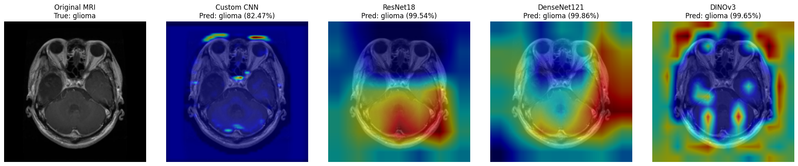 |
| **Meningioma** | 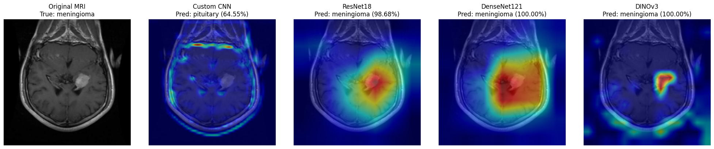 |
| **No Tumor** | 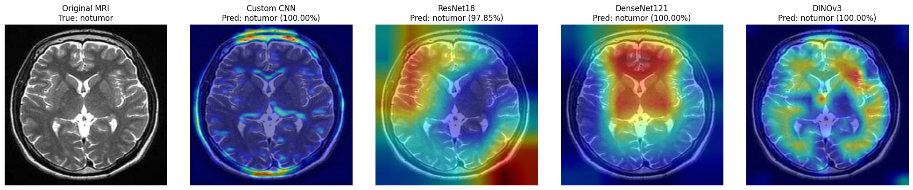 |
| **Pituitary** | 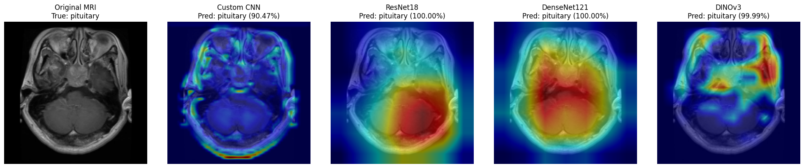 |

### Correct vs. Incorrect Prediction Cases

- **All Models Correct:**
  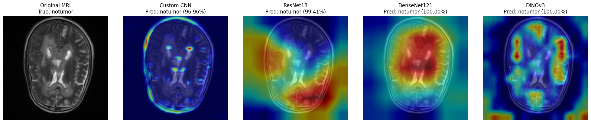
- **Custom CNN Wrong — Pretrained Models Correct:**
  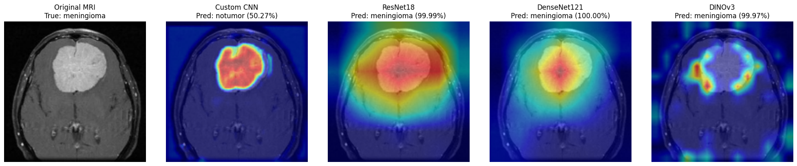
- **ResNet-18 Correct — DenseNet-121 Wrong:**
  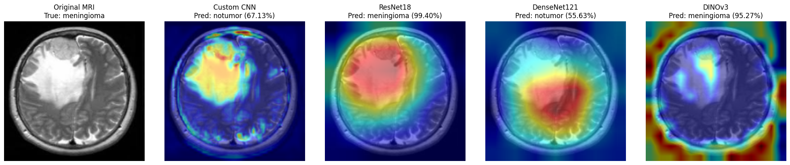
- **DenseNet-121 Correct — ResNet-18 Wrong:**
  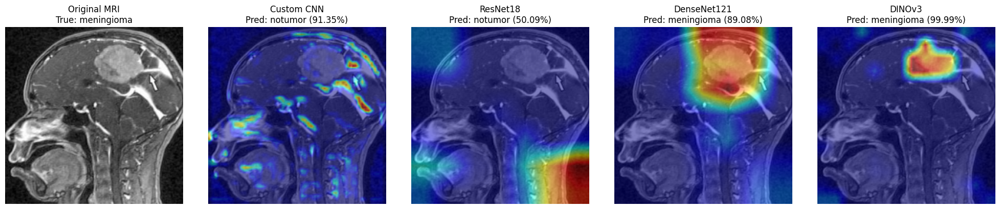
- **DINOv3 Wrong — ResNet-18 & DenseNet-121 Correct:**
  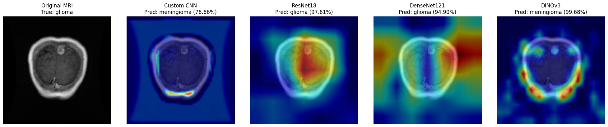

---

## Limitations and Future Work

This project is intended for educational and experimental purposes and should not be used for clinical diagnosis. Key technical limitations and directions for future research include:

- **Dataset Scope & Generalization:** Evaluation was limited to a single 4-class dataset without verified patient-level splits or duplicate checks. Future work should investigate potential data leakage, adopt patient-level splitting, and validate on external multi-center datasets.
- **Architecture & Hyperparameter Exploration:** Beyond the four tested models, future experiments could evaluate architectures with different efficiency trade-offs (e.g., EfficientNet, ConvNeXt, MobileNet variants) alongside systematic hyperparameter tuning and alternative unfreezing schedules.
- **Deployment Benchmarking:** The current comparison focuses on accuracy and parameter counts. Assessing inference latency, memory footprint, and energy consumption is needed to determine real-world deployment feasibility.
- **Explainability & Clinical Reliability:** Grad-CAM heatmaps did not always align with apparent tumor regions (especially for DINOv3), and ground-truth segmentation masks were unavailable to verify attributions. Future work should explore Transformer-specific explainability methods (e.g., Attention Rollout, LRP) and test robustness against varying MRI quality.

---

## References

1. I. Tanvir, A. Ruslan, and S. Solaiman, "Comparative Analysis of Custom CNN Architectures versus Pre-trained Models and Transfer Learning: A Study on Five Bangladesh Datasets," *arXiv preprint arXiv:2601.04352*, 2026. [https://arxiv.org/abs/2601.04352](https://arxiv.org/abs/2601.04352)
2. K. He, X. Zhang, S. Ren, and J. Sun, "Deep Residual Learning for Image Recognition," *CVPR*, 2016. [https://arxiv.org/abs/1512.03385](https://arxiv.org/abs/1512.03385)
3. G. Huang, Z. Liu, L. van der Maaten, and K. Q. Weinberger, "Densely Connected Convolutional Networks," *CVPR*, 2017. [https://arxiv.org/abs/1608.06993](https://arxiv.org/abs/1608.06993)
4. O. Siméoni et al., "DINOv3," *arXiv preprint arXiv:2508.10104*, 2025. [https://arxiv.org/abs/2508.10104](https://arxiv.org/abs/2508.10104)
5. R. R. Selvaraju et al., "Grad-CAM: Visual Explanations from Deep Networks via Gradient-Based Localization," *ICCV*, 2017. [https://arxiv.org/abs/1610.02391](https://arxiv.org/abs/1610.02391)
